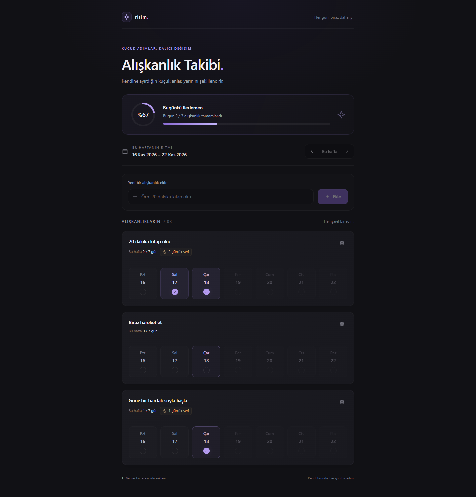
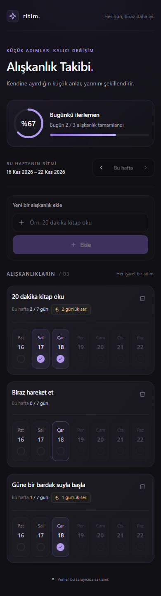

<div align="center">


<br />
<br />

**Alışkanlıklarına yer aç. İlerlemeni gör. Kendi ritmini bul.**

Türkçe, sade ve koyu temalı bir alışkanlık takip uygulaması.<br />
Bir hedef ekle, tamamladığın günleri işaretle ve küçük adımlarının birikmesini izle.

<br />


<br />
<br />

[Önizleme](#önizleme) · [Özellikler](#özellikler) · [Hızlı başlangıç](#hızlı-başlangıç) · [Geliştirme](#geliştirme)

</div>

<br />

## Önizleme

Yumuşak mor vurgular, dairesel ilerleme göstergesi ve haftanı bir bakışta görmeni sağlayan kartlar.



<details>
<summary><strong>📱 Mobil görünümü incele</strong></summary>

<br />

<p align="center">
  
</p>

</details>

*Görseller örnek alışkanlıklarla alınmıştır. Uygulama ilk açılışta boş bir listeyle başlar.*

## Özellikler

| | Ritim ile |
| :--- | :--- |
| **✦ Günlük odak** | Bugün tamamladığın alışkanlıkları sayı, yüzde ve ilerleme halkasıyla gör. |
| **✓ Bir dokunuşla takip** | Tamamladığın günleri işaretle; gerektiğinde işareti kaldır. Gelecek günler kapalı kalır. |
| **↔ Haftalık görünüm** | Pazartesi başlayan haftalar arasında gezin, geçmiş kayıtlarını düzenle ve bu haftaya dön. |
| **🔥 Günlük seri** | Art arda tamamladığın günleri takip et. Bugün henüz bitirmediysen dün biten serin korunur. |
| **↶ Geri alma** | Bir alışkanlığı silersen son sildiğin kaydı geri getir. |
| **◈ Yerel kayıt** | Verilerini aynı tarayıcıda sakla; hesap açmadan ve API anahtarı girmeden başla. |
| **⌨ Erişilebilir kullanım** | Klavye odağı, ekran okuyucu etiketleri ve azaltılmış hareket tercihine uygun geçişler. |
| **📱 Her ekrana uyum** | Mobil ve masaüstünde aynı sade deneyim; Türkçe arayüz ve tarihler. |

Boş isimler, 80 karakteri aşan adlar ve aynı adlı alışkanlıklar engellenir. İsimlerin başındaki ve sonundaki boşluklar temizlenir.

## Hızlı başlangıç

**Gereksinimler:** Node.js **22.18+** ve npm. Önerilen ortam: `.nvmrc` içindeki **Node.js 22.23.1** ve Node ile gelen **npm 10**.

Projeyi indirdikten veya klonladıktan sonra proje klasöründe:

```sh
npm ci
npm run dev
```

Terminalde gösterilen yerel adresi tarayıcında aç. Ortam dosyası, sunucu kurulumu veya harici servis bağlantısı gerekmez.

> **İlk adımın:** “20 dakika kitap oku” gibi küçük bir alışkanlık ekle. Tamamladığın günü işaretle; ilerleme özeti ve serin otomatik güncellensin.

## Geliştirme

Tüm kontrolleri tek komutla çalıştır:

```sh
npm run check
```

| Komut | İşlev |
| :--- | :--- |
| `npm run dev` | Canlı yenilemeli geliştirme sunucusu |
| `npm run lint` | Kaynak kodu ve testler için ESLint kontrolü |
| `npm test` | Node.js test çalıştırıcısıyla birim testleri |
| `npm run build` | TypeScript kontrolü ve `dist/` klasörüne üretim derlemesi |
| `npm run preview` | Derlenmiş uygulamanın yerel önizlemesi |
| `npm run check` | Sırayla lint, test ve derleme |
| `npm audit` | Bağımlılık güvenlik taraması |

Testler; kayıt doğrulaması, bozuk veriler, gün işaretleme, gelecek tarih engeli, artık yıl ve seri hesabının tarih sınırlarını kapsar.

[GitHub Actions iş akışı](.github/workflows/ci.yml), her push ve pull request için **Windows ve Ubuntu** üzerinde `npm ci` ve `npm run check` çalıştırır. İş akışındaki action sürümleri commit kimliklerine sabitlenmiştir.

<details>
<summary><strong>Proje yapısı</strong></summary>

```text
.
├── .github/workflows/ci.yml   # Otomatik kontroller
├── docs/images/              # README kapağı ve ekran görüntüleri
├── public/                   # Favicon ve statik dosyalar
├── src/
│   ├── components/
│   │   ├── Button.tsx        # Ortak düğme stilleri
│   │   ├── HabitForm.tsx     # Alışkanlık ekleme ve doğrulama
│   │   ├── HabitList.tsx     # Kartlar ve günlük işaretleme
│   │   ├── Header.tsx        # İlerleme özeti ve hafta seçimi
│   │   └── Icon.tsx          # SVG ikonları
│   ├── App.tsx               # Uygulama durumu ve yerel kayıt
│   ├── habits.ts             # Veri doğrulama ve seri hesabı
│   └── index.css             # Tema ve bileşen stilleri
└── tests/habits.test.mjs      # Alışkanlık mantığı testleri
```

</details>

## Verilerin nasıl saklanır?

Alışkanlıklar ve işaretlediğin günler, `habit-tracker:v1` anahtarıyla tarayıcının **localStorage** alanında tutulur.

- Sayfayı yenilediğinde kayıtların aynı tarayıcıda kalır. Cihazlar veya sekmeler arasında canlı eşitleme yapılmaz.
- Tarayıcı verilerini temizlemek kayıtları kaldırır. Yerel kayıt, ayrı bir yedekleme hizmeti değildir.
- Bozuk kayıt algılanırsa otomatik olarak üzerine yazılmaz. Yeni kaydı başlatmak için ekrandaki düğmeyi kullanabilirsin.
- Depolama kullanılamazsa uygulama uyarı gösterir ve oturum boyunca çalışmaya devam eder.
- Günler cihazın yerel saatine göre hesaplanır; açık sayfada tarih düzenli olarak ve pencereye döndüğünde yenilenir.

<details>
<summary><strong>Seri ve geri alma davranışı</strong></summary>

Bir günlük boşluk seriyi sıfırlar. Bugün henüz işaretlenmediyse dün sona eren seri gösterilir; bugünü tamamladığında devam eder.

Geri alma yalnızca son silinen alışkanlık için geçerlidir ve sayfa yenilendiğinde kaybolur. Silinen alışkanlıkla aynı adda yeni bir alışkanlık eklersen eski geri alma seçeneği kaldırılır.

</details>

## Yayınlama

```sh
npm run build
npm run preview
```

Üretim dosyaları **`dist/`** klasöründe oluşur. Bu klasör statik barındırma hizmetlerine yüklenebilir. GitHub'a kaynak kodu göndermek uygulamayı otomatik yayımlamaz; mevcut CI iş akışı yalnızca kontrolleri çalıştırır.

**GitHub Pages:** Uygulamayı bir depo alt dizininde yayımlayacaksan `vite.config.ts` içindeki `base` değerini depo yoluna göre ayarla.

<details>
<summary><strong>İlk kez GitHub'a gönderme</strong></summary>

GitHub üzerinde README, lisans veya gitignore eklemeden boş bir depo oluştur. Değişikliklerini commit ettikten sonra aşağıdaki adreste kendi kullanıcı ve depo adını kullan:

```sh
git remote add origin https://github.com/KULLANICI/DEPO.git
git push -u origin main
```

`node_modules/`, `dist/`, ortam dosyaları ve yerel test çıktıları Git dışında tutulur. Tekrarlanabilir kurulum için `package-lock.json` depoya dahildir.

</details>

---

<div align="center">

**Büyük değişimler, küçük tekrarlarla başlar.**

<sub>Kendi hızında. Kendi ritminde.</sub>

</div>
